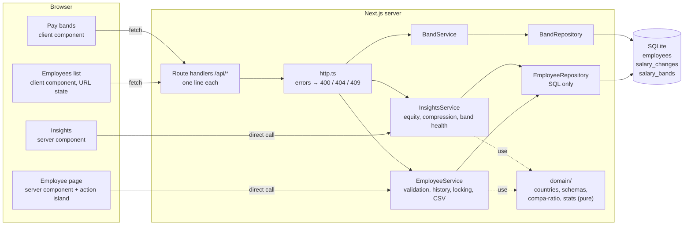

# Architecture

One Next.js app serves the API and the UI. All business logic lives in plain TypeScript under `src/server`, which imports nothing from Next.js or React and is tested on its own.



## Layers

| Layer | Where | Responsibility | Tests |
|---|---|---|---|
| Domain | `src/server/domain` | Countries and currency, Zod schemas, compa-ratio, range penetration, pay gap, tenure, stats. Pure functions. | `compensation.test.ts`, `schemas.test.ts` |
| Repositories | `src/server/repositories` | SQL and row mapping only. Whitelisted sort columns, bound parameters, escaped `LIKE`. | `repositories.test.ts` on in-memory SQLite |
| Services | `src/server/services` | Business rules: salary change rules, optimistic locking, defaults for bad query params, CSV, all insight calculations. | `employeeService.test.ts`, `insightsService.test.ts` |
| HTTP | `src/app/api`, `src/server/http.ts` | Parse request, call one service method, map errors to status codes. | `api.test.ts`: real handlers against in-memory SQLite |
| UI | `src/app`, `src/components` | Rendering and input. Server components read services directly; client components use the JSON API. | Manual + demo video |

Dependencies point inward only. `src/server/container.ts` is the one place real dependencies are wired; tests wire their own with `:memory:` databases, so the full suite runs in about a second.

## Data model

```
employees                         salary_changes                     salary_bands
---------                         --------------                     ------------
id                PK              id               PK                id           PK
employee_code     EMP-00042       employee_id      FK → employees    country
full_name                         previous_salary  NULL for hire     job_title
email             UNIQUE          new_salary                         min_salary
job_title  ┐                      effective_date                     mid_salary
country    ┴──── joins band ────► reason           hire|merit|...    max_salary
department                        note                               UNIQUE (country, job_title)
gender            for equity      created_at                         CHECK min < mid < max
hire_date
status            active|inactive
salary            INTEGER, current
version           optimistic lock
```

- **Money is INTEGER** whole units of local currency. No floating point money anywhere.
- **Currency is derived** from the country, never stored, so a salary cannot exist in the wrong currency.
- **`employees.salary` is the current salary**, kept in the same transaction as the newest `salary_changes` row. Reading the list never has to aggregate history.
- **Bands join on (country, job_title)**, so editing one band updates compa-ratios everywhere instantly, with no data migration.

## Key flows

**Changing a salary** (`POST /api/employees/:id/salary`)
1. Validate amount, date, reason with Zod.
2. Reject if the employee is inactive (409), if the date is before hire or before the last change, or if the amount is unchanged (400, per field).
3. In one transaction: append a `salary_changes` row with `previous_salary`, update `employees.salary`, bump `version`.
4. Return the employee with new compa-ratio and the % change.

**Editing a profile** (`PATCH /api/employees/:id`)
The client sends the `version` it loaded. `UPDATE ... WHERE id = ? AND version = ?` changes nothing if someone saved in between; the service turns that into 409 and the form tells the user to reload, instead of silently overwriting.

**Insights**
One indexed query loads active employees with their band (`payFacts`), then every insight is a pure pass over that array in `InsightsService`. Medians are exact (SQLite has no median function), and every calculation is unit tested without HTTP.
